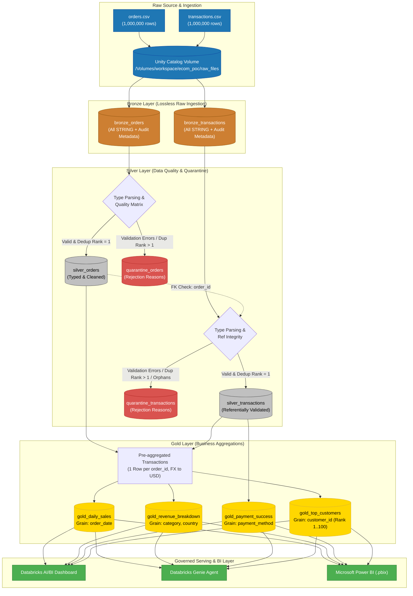
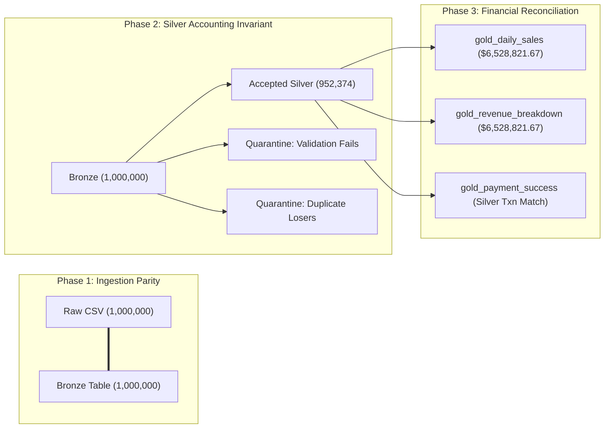
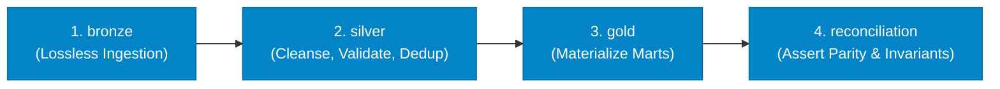

# Enterprise E-Commerce Medallion Lakehouse on Databricks

[](https://www.databricks.com/)
[](https://spark.apache.org/)
[](https://www.databricks.com/product/unity-catalog)
[](https://powerbi.microsoft.com/)
[](https://www.databricks.com/product/workflows)

An end-to-end, production-grade **Medallion Architecture (Bronze &rarr; Silver &rarr; Gold)** data pipeline engineered on **Databricks Unity Catalog**. This solution ingests high-volume raw transactional records, enforces strict schema validation and business data quality rules, isolates anomalies into dead-letter quarantine tables, materializes dimensional business marts, and provides governed self-service analytics via **Databricks AI/BI Dashboards**, **Genie Natural Language Spaces**, and **Power BI**.

---

## Table of Contents

- [1. Architecture Overview](#1-architecture-overview)
- [2. Repository Structure](#2-repository-structure)
- [3. Pipeline Stages & Implementation Details](#3-pipeline-stages--implementation-details)
  - [Synthetic Data Generation](#synthetic-data-generation)
  - [Bronze Layer: Lossless Raw Ingestion](#bronze-layer-lossless-raw-ingestion)
  - [Silver Layer: Cleansing, Quality Matrix & Deduplication](#silver-layer-cleansing-quality-matrix--deduplication)
  - [Gold Layer: Governed Dimensional Marts](#gold-layer-governed-dimensional-marts)
- [4. Mathematical Invariants & Data Reconciliation](#4-mathematical-invariants--data-reconciliation)
- [5. Reporting, AI/BI & Power BI Integration](#5-reporting-aibi--power-bi-integration)
  - [Databricks AI/BI Dashboard](#databricks-aibi-dashboard)
  - [Databricks Genie Agent Verification](#databricks-genie-agent-verification)
  - [Power BI Report & Cross-Tool Reconciliation](#power-bi-report--cross-tool-reconciliation)
- [6. Security & Governance (Unity Catalog RBAC)](#6-security--governance-unity-catalog-rbac)
- [7. Orchestration & Production Workflows](#7-orchestration--production-workflows)
- [8. Deployment & Execution Guide](#8-deployment--execution-guide)
- [9. Data Dictionary](#9-data-dictionary)

---

## 1. Architecture Overview



---

## 2. Repository Structure

```
.
├── .gitignore
├── README.md                                    # Project documentation & architecture manual
├── dashboards/
│   ├── E-commerce Sales Dashboard.lvdash.json   # Databricks AI/BI (Lakeview) dashboard export
│   └── .E-commerce Sales Dashboard.lvdash.json.crc
├── data/
│   ├── orders.csv                               # Synthetic raw source dataset (1M rows, ~71 MB)
│   └── transactions.csv                         # Synthetic raw source dataset (1M rows, ~73 MB)
├── generator/
│   └── generate_dataset.py                      # Data generation script with deliberate anomalies
├── notebooks/
│   ├── setup.ipynb                              # Workspace, catalog, schema & volume setup
│   ├── bronze.ipynb                             # Lossless ingestion & audit tagging (Delta)
│   ├── silver.ipynb                             # Data cleansing, validation matrix, quarantine routing
│   ├── gold.ipynb                               # Dimensional aggregations, financial logic & Genie verification
│   └── reconciliation.ipynb                     # 3-phase mathematical reconciliation test suite
├── operations/
│   └── ETL_Pipeline.yaml                        # Databricks Workflow job definition (YAML)
├── powerbi/
│   └── Databricks-Medallion-BI-Dashboard.pbix   # Power BI production dashboard connected to Gold tables
└── sql/
    ├── 00_setup.sql                             # Schema & raw volume provisioning
    ├── 01_source_and_bronze_checks.sql          # Source-to-Bronze row parity & schema assertions
    ├── 02_silver_quality_checks.sql             # Silver data-quality & 100% row accounting assertions
    ├── 03_gold_validation.sql                  # Gold business logic & independent financial recalculation
    ├── 04_reporting_grants.sql                  # Unity Catalog least-privilege security model
    └── 05_powerbi_reconciliation.sql            # Cross-tool metric parity (SQL vs AI/BI vs Power BI)
```

---

## 3. Pipeline Stages & Implementation Details

### Synthetic Data Generation
Script: [`generator/generate_dataset.py`](file:///g:/Databricks-Medallion-Project/generator/generate_dataset.py)

Generates 2,000,000 total records seeded for reproducibility (`seed=42`) with realistic distributed anomalies to rigorously test the lakehouse data quality controls:

- **Orders (`orders.csv` - 1,000,000 records)**:
  - 10,000 duplicate order IDs.
  - 20,000 blank/missing `customer_id` values.
  - 5,000 invalid date strings (e.g. `2023-02-30`, `not-a-date`, `31/13/2024`, `2024-99-01`).
  - 3,000 invalid quantity values (`"invalid"`).
  - 8,000 negative unit prices (`-$XX.XX`).
  - 3,000 corrupted unit prices (`"N/A"`).
  - Distribution of statuses: `PLACED` (12%), `SHIPPED` (18%), `DELIVERED` (48%), `CANCELLED` (12%), `RETURNED` (10%).
- **Transactions (`transactions.csv` - 1,000,000 records)**:
  - 15,000 orphan transaction records pointing to non-existent `ORPHANXXXXXXXX` order IDs.
  - 5,000 non-numeric amount values (`"invalid"`, `"N/A"`, `"unknown"`).
  - 12,000 misspelled or unknown payment statuses (`"SUCCES"`, `"PAIDD"`, `"UNKNOWN"`, `"COMPLETEE"`).
  - Multi-currency transactions: `BDT`, `USD`, `GBP`, `EUR`, `INR`, `CAD`, `AUD`, `JPY`, `SGD`.
  - Payment methods: `CARD` (42%), `MOBILE_WALLET` (22%), `BANK_TRANSFER` (18%), `CASH` (10%), `PAYPAL` (8%).

---

### Bronze Layer: Lossless Raw Ingestion
Notebook: [`notebooks/bronze.ipynb`](file:///g:/Databricks-Medallion-Project/notebooks/bronze.ipynb) | SQL Checks: [`sql/01_source_and_bronze_checks.sql`](file:///g:/Databricks-Medallion-Project/sql/01_source_and_bronze_checks.sql)

- **Pure STRING Schema**: Read with explicit string types—no schema inference. Zero records are rejected during ingestion, capturing raw source fidelity exactly as generated.
- **Audit Metadata Enrichment**: Every ingested record is tagged with:
  - `_ingested_at` (`TIMESTAMP`): UTC ingestion timestamp.
  - `_source_file` (`STRING`): Origin filename (`orders.csv` or `transactions.csv`).
  - `_batch_id` (`STRING`): Unique execution batch ID (`bronze_YYYYMMDD_HHMMSS`).
  - `_row_hash` (`STRING`): SHA-256 fingerprint generated across all raw source columns.
- **Tables Created**:
  - `workspace.ecom_poc.bronze_orders` (1,000,000 rows)
  - `workspace.ecom_poc.bronze_transactions` (1,000,000 rows)

---

### Silver Layer: Cleansing, Quality Matrix & Deduplication
Notebook: [`notebooks/silver.ipynb`](file:///g:/Databricks-Medallion-Project/notebooks/silver.ipynb) | SQL Checks: [`sql/02_silver_quality_checks.sql`](file:///g:/Databricks-Medallion-Project/sql/02_silver_quality_checks.sql)

The Silver layer enforces schema constraints, type casting, domain validations, referential integrity, and deterministic deduplication.

#### 1. Safe Casting & String Normalization
Uses `try_cast()` to prevent job aborts due to formatting errors; invalid values evaluate to `NULL` and are flagged by downstream validation checks. Text fields are trimmed, statuses lowercased, and countries uppercased.

#### 2. Business Rules Validation Matrix
Rows that fail any validation rule are rejected and enriched with descriptive pipes-delimited rejection reasons:

| Dataset | Failure Condition | Reason Flag |
|---|---|---|
| **Orders** | Null / empty `order_id` | `NULL_ORDER_ID` |
| **Orders** | Null / empty `customer_id` | `NULL_CUSTOMER_ID` |
| **Orders** | Unparseable date or > `current_date()` | `INVALID_ORDER_DATE` / `FUTURE_ORDER_DATE` |
| **Orders** | Unparseable or &le; 0 `quantity` | `INVALID_QUANTITY` / `NONPOSITIVE_QUANTITY` |
| **Orders** | Unparseable or &le; 0 `unit_price` | `INVALID_UNIT_PRICE` / `NONPOSITIVE_UNIT_PRICE` |
| **Orders** | Status not in (`delivered`, `shipped`, `placed`, `cancelled`, `returned`) | `INVALID_ORDER_STATUS` |
| **Orders** | Category not in approved list | `INVALID_CATEGORY` |
| **Orders** | Null / empty `country` | `NULL_COUNTRY` |
| **Transactions** | Null / empty `txn_id` | `NULL_TXN_ID` |
| **Transactions** | Null / empty `order_id` | `NULL_ORDER_ID` |
| **Transactions** | Unparseable or &le; 0 `amount` | `INVALID_AMOUNT` / `NONPOSITIVE_AMOUNT` |
| **Transactions** | Status not in (`success`, `failed`, `pending`, `refunded`) | `INVALID_STATUS` |
| **Transactions** | Payment method not in approved list | `INVALID_METHOD` |
| **Transactions** | Unparseable or future `txn_ts` | `INVALID_TIMESTAMP` / `FUTURE_TIMESTAMP` |
| **Transactions** | Currency not in approved 9 currencies | `INVALID_CURRENCY` |
| **Transactions** | `order_id` missing from valid `silver_orders` | `ORPHAN_ORDER_ID` |

#### 3. Deterministic Deduplication
- Partitions valid records by natural key (`order_id` or `txn_id`) and ranks by `ORDER BY _row_hash`.
- Rank 1 is written to `silver_*`.
- Rank &gt; 1 is routed to `quarantine_*` with reason `'DUPLICATE_ORDER_ID'` or `'DUPLICATE_TXN_ID'`.

#### 4. Tables Created
- `silver_orders` (Accepted clean orders)
- `quarantine_orders` (Validation failures + duplicate losers)
- `silver_transactions` (Accepted clean transactions with foreign key validity)
- `quarantine_transactions` (Validation failures + duplicate losers + orphan transactions)

---

### Gold Layer: Governed Dimensional Marts
Notebook: [`notebooks/gold.ipynb`](file:///g:/Databricks-Medallion-Project/notebooks/gold.ipynb) | SQL Validation: [`sql/03_gold_validation.sql`](file:///g:/Databricks-Medallion-Project/sql/03_gold_validation.sql)

Gold layer marts provide pre-aggregated, business-ready models optimized for interactive analytics.

#### Enterprise Revenue Recognition Rule
1. **Pre-aggregation**: Transactions are pre-aggregated to **one record per `order_id`** prior to joining to prevent cardinality fan-out.
2. **Recognition Policy**: Revenue is recognized **only on orders with `order_status = 'shipped'`**. Orders that are `delivered`, `placed`, `returned`, or `cancelled` are retained in order volume counts, but contribute `$0.00` to revenue.
3. **Net Revenue Formula**:
   $$\text{Net Revenue} = \text{Eligible Revenue (Success Payments)} - \text{Refunded Payments}$$
4. **Currency Normalization**: Transaction amounts are converted to USD (1.0 conversion rate baseline for this POC).

#### Materialized Marts:
1. **`gold_daily_sales`**:
   - **Grain**: One row per calendar date (`order_date`).
   - **Metrics**: `order_count`, `eligible_order_count`, `cancelled_order_count`, `cancellation_rate` (weighted calculation: $\frac{\sum \text{cancelled}}{\sum \text{orders}}$), `eligible_revenue`, `net_revenue`.
2. **`gold_revenue_breakdown`**:
   - **Grain**: One row per `(category, country)`.
   - **Metrics**: `order_count`, `customer_count` (distinct count of customers), `eligible_revenue`, `net_revenue`, `revenue_share` (share of total enterprise eligible revenue).
3. **`gold_payment_success`**:
   - **Grain**: One row per `payment_method`.
   - **Scope**: Spans all transactions across all order types to monitor overall payment gateway health.
   - **Metrics**: `transaction_count`, `successful_count`, `success_rate` ($\frac{\sum \text{successful}}{\sum \text{total}}$), `total_amount_usd`.
4. **`gold_top_customers`**:
   - **Grain**: One row per `customer_id`.
   - **Filter & Rank**: Top 100 spenders ranked by `eligible_spend DESC` with spend &gt; 0.
   - **Metrics**: `eligible_spend`, `net_spend`, `eligible_order_count`, `spend_rank`.

---

## 4. Mathematical Invariants & Data Reconciliation

Notebook: [`notebooks/reconciliation.ipynb`](file:///g:/Databricks-Medallion-Project/notebooks/reconciliation.ipynb)

A dedicated, automated 3-phase audit notebook proves zero data loss and 100% financial consistency across the entire pipeline.



### 1. Ingestion Parity (Phase 1)
- Source CSV count = Bronze Delta count = **1,000,000** for both Orders and Transactions.
- Audit columns (`_ingested_at`, `_source_file`, `_batch_id`, `_row_hash`) present with 0 NULL values.

### 2. Silver Accounting Invariant (Phase 2)
The lakehouse enforces strict conservation of records:
$$\text{Bronze Rows} = \text{Silver Accepted Rows} + \text{Quarantine Validation Failures} + \text{Quarantine Duplicate Losers}$$

- **Zero Overlap**: $\text{Silver} \cap \text{Quarantine} = \emptyset$ (evaluated via `_row_hash`).
- **Complete Coverage**: $\text{Silver} \cup \text{Quarantine} = \text{Bronze}$.
- **Zero In-Table Duplicates**: Distinct count of `_row_hash` equals row count in both Silver and Quarantine.

### 3. Financial & Cross-Mart Parity (Phase 3)
- $\sum \text{eligible\_revenue}$ in `gold_daily_sales` ($6,528,821.67) $\equiv \sum \text{eligible\_revenue}$ in `gold_revenue_breakdown` ($6,528,821.67).
- $\sum \text{net\_revenue}$ in `gold_daily_sales` ($6,191,944.52) $\equiv \sum \text{net\_revenue}$ in `gold_revenue_breakdown` ($6,191,944.52).
- $\sum \text{order\_count}$ across `gold_daily_sales` ($952,374$) $\equiv$ total rows in `silver_orders` ($952,374$).
- $\sum \text{transaction\_count}$ across `gold_payment_success` $\equiv$ total rows in `silver_transactions`.

---

## 5. Reporting, AI/BI & Power BI Integration

### Databricks AI/BI Dashboard
Dashboard Definition: [`dashboards/E-commerce Sales Dashboard.lvdash.json`](file:///g:/Databricks-Medallion-Project/dashboards/E-commerce%20Sales%20Dashboard.lvdash.json)

The lakehouse features an interactive Databricks AI/BI (Lakeview) dashboard built on top of the Gold layer marts:
- **Executive Counter KPIs**:
  - Total Eligible Revenue: `$6,528,821.67`
  - Net Revenue: `$6,191,944.52`
  - Total Orders: `952,374`
  - Overall Cancellation Rate: `12.0%` (weighted formula: `SUM(cancelled_order_count) / SUM(order_count)`)
- **Visualizations**:
  - Monthly Revenue Trend (Temporal Line Chart)
  - Cancellation Rate Trend (Temporal Line Chart)
  - Revenue by Category (Categorical Bar Chart)
  - Revenue by Category $\times$ Country (Matrix Table with `revenue_share`)
  - Payment Success Rate by Payment Method (Categorical Bar Chart)
  - Top 10 Spenders (Bar Chart) & Top 100 Customers (Ranked Grid)
- **Interactive Filtering**: Global date-range filter on `order_date`.

---

### Databricks Genie Agent Verification
Genie Space: **E-commerce Gold Sales Analytics** (ID: `01f1e34620fa133f9a73a768020d9ad3`)

The 4 Gold tables were attached to a Databricks Genie Space to support conversational natural-language business queries. Cross-verification against standalone Databricks SQL confirmed zero divergence:

| # | Business Question | Verified Ground-Truth SQL | Genie Agent Output | Status |
|---|---|---|---|:---:|
| 1 | *What is the total eligible revenue across all dates?* | **$6,528,821.67** | **$6,528,821.67** | Pass |
| 2 | *Which product category has the highest eligible revenue?* | **Sports** ($944,994.99) | **Sports** ($944,994.99) | Pass |
| 3 | *What is the payment success rate for card transactions?* | **77.99%** (302,339 / 387,641) | **77.99%** (302,339 / 387,641) | Pass |

---

### Power BI Report & Cross-Tool Reconciliation
File: [`powerbi/Databricks-Medallion-BI-Dashboard.pbix`](file:///g:/Databricks-Medallion-Project/powerbi/Databricks-Medallion-BI-Dashboard.pbix) | Audit Script: [`sql/05_powerbi_reconciliation.sql`](file:///g:/Databricks-Medallion-Project/sql/05_powerbi_reconciliation.sql)

The Power BI report connects to the Databricks SQL Warehouse using DirectQuery / Import mode over the Gold tables.

#### Cross-Tool Metric Parity Table
Under identical filter conditions (all dates, USD reporting currency), all three reporting surfaces yield the exact same metrics:

| Metric | Standalone Databricks SQL | Databricks AI/BI Dashboard | Power BI (`.pbix`) | Parity Status |
|---|---|---|---|:---:|
| **Total Eligible Revenue** | `$6,528,821.67` | `$6,528,821.67` | `$6,528,821.67` | MATCH |
| **Net Revenue** | `$6,191,944.52` | `$6,191,944.52` | `$6,191,944.52` | MATCH |
| **Total Orders** | `952,374` | `952,374` | `952,374` | MATCH |
| **Overall Cancellation Rate** | `12.0%` | `12.0%` | `12.0%` | MATCH |
| **Top Spender Category** | Sports ($944,994.99) | Sports ($944,994.99) | Sports ($944,994.99) | MATCH |

> [!NOTE]
> Because `gold_daily_sales` (grain: `order_date`) and `gold_revenue_breakdown` (grain: `category, country`) operate at different grains, queries requiring combined filtering (e.g. specific date range *and* specific category) are reconciled against the Silver reference model provided in Section 3 of `05_powerbi_reconciliation.sql`.

---

## 6. Security & Governance (Unity Catalog RBAC)

Script: [`sql/04_reporting_grants.sql`](file:///g:/Databricks-Medallion-Project/sql/04_reporting_grants.sql)

Access control adheres to the principle of **least privilege**:
- **Reporting Analysts / Power BI Service Principals**:
  - `GRANT USE CATALOG ON CATALOG workspace TO reporting_role;`
  - `GRANT USE SCHEMA ON SCHEMA workspace.ecom_poc TO reporting_role;`
  - `GRANT SELECT ON TABLE gold_daily_sales TO reporting_role;`
  - `GRANT SELECT ON TABLE gold_revenue_breakdown TO reporting_role;`
  - `GRANT SELECT ON TABLE gold_payment_success TO reporting_role;`
  - `GRANT SELECT ON TABLE gold_top_customers TO reporting_role;`
- **Zero Access to Raw / Intermediate Data**:
  - No permissions granted on `/Volumes/.../raw_files`.
  - No access to `bronze_*`, `silver_*`, or `quarantine_*` tables.
  - Zero schema-level `SELECT` or `CREATE TABLE` permissions to eliminate accidental data exposure.
- **Audit Assertions**: Script includes automated SQL assertion queries ensuring non-Gold table access violations and non-SELECT privileges equal `0`.

---

## 7. Orchestration & Production Workflows

Workflow Definition: [`operations/ETL_Pipeline.yaml`](file:///g:/Databricks-Medallion-Project/operations/ETL_Pipeline.yaml)



- **Execution Cadence**: Scheduled daily (`interval: 1 DAYS`).
- **Resilience**:
  - Task retries: `max_retries: 2`, `retry_on_timeout: true`.
  - Fail-fast validation: If Phase 1, Phase 2, or Phase 3 reconciliation checks fail, the workflow immediately raises an `AssertionError` and alerts engineers.
- **Notification**: Automated alerts dispatched `on_success` and `on_failure`.
- **Dynamic Parameterization**: Configured via task-level base parameters (`catalog: workspace`, `schema: ecom_poc`, `volume: raw_files`).

---

## 8. Deployment & Execution Guide

### Prerequisites
1. Databricks Workspace enabled with **Unity Catalog**.
2. A SQL Warehouse (Serverless or Pro) or compute cluster running **Databricks Runtime 14.3+ LTS**.
3. Local environment with Python 3.10+ (for synthetic data regeneration).

### Step-by-Step Setup

#### Step 1: Generate Raw Data (Optional)
The pre-generated datasets reside in `/data`. To regenerate fresh sets:
```bash
pip install pandas numpy
python generator/generate_dataset.py
```

#### Step 2: Initialize Unity Catalog Objects
Run [`sql/00_setup.sql`](file:///g:/Databricks-Medallion-Project/sql/00_setup.sql) or [`notebooks/setup.ipynb`](file:///g:/Databricks-Medallion-Project/notebooks/setup.ipynb) in Databricks:
```sql
USE CATALOG workspace;
CREATE SCHEMA IF NOT EXISTS ecom_poc;
CREATE VOLUME IF NOT EXISTS ecom_poc.raw_files;
```

#### Step 3: Upload Raw Files to Volume
Upload `orders.csv` and `transactions.csv` to:
`/Volumes/workspace/ecom_poc/raw_files/`

#### Step 4: Run the Medallion Pipeline
Run the notebooks in sequential order or import [`operations/ETL_Pipeline.yaml`](file:///g:/Databricks-Medallion-Project/operations/ETL_Pipeline.yaml) into **Databricks Workflows**:
1. [`notebooks/bronze.ipynb`](file:///g:/Databricks-Medallion-Project/notebooks/bronze.ipynb)
2. [`notebooks/silver.ipynb`](file:///g:/Databricks-Medallion-Project/notebooks/silver.ipynb)
3. [`notebooks/gold.ipynb`](file:///g:/Databricks-Medallion-Project/notebooks/gold.ipynb)
4. [`notebooks/reconciliation.ipynb`](file:///g:/Databricks-Medallion-Project/notebooks/reconciliation.ipynb)

#### Step 5: Execute SQL Quality Check Suite
Run the validation scripts in the Databricks SQL Editor:
- [`sql/01_source_and_bronze_checks.sql`](file:///g:/Databricks-Medallion-Project/sql/01_source_and_bronze_checks.sql) &rarr; Verify row counts and string schema.
- [`sql/02_silver_quality_checks.sql`](file:///g:/Databricks-Medallion-Project/sql/02_silver_quality_checks.sql) &rarr; Verify zero violation count on business rules and deduplication.
- [`sql/03_gold_validation.sql`](file:///g:/Databricks-Medallion-Project/sql/03_gold_validation.sql) &rarr; Verify primary key uniqueness, foreign keys, and financial totals.
- [`sql/04_reporting_grants.sql`](file:///g:/Databricks-Medallion-Project/sql/04_reporting_grants.sql) &rarr; Apply least-privilege security roles.
- [`sql/05_powerbi_reconciliation.sql`](file:///g:/Databricks-Medallion-Project/sql/05_powerbi_reconciliation.sql) &rarr; Reconcile metrics across Databricks SQL, Lakeview, and Power BI.

---

## 9. Data Dictionary

### Gold Tables

#### `workspace.ecom_poc.gold_daily_sales`
| Column Name | Data Type | Description |
|---|---|---|
| `order_date` | `DATE` | Calendar date of order placement (Primary Key). |
| `order_count` | `BIGINT` | Total orders placed on this date (all statuses). |
| `eligible_order_count` | `BIGINT` | Shipped orders eligible for revenue recognition. |
| `cancelled_order_count`| `BIGINT` | Orders with status `cancelled`. |
| `cancellation_rate` | `DECIMAL(9,6)` | Ratio of cancelled orders to total orders ($[0..1]$). |
| `eligible_revenue` | `DECIMAL(28,2)` | Gross USD revenue from successful payments on shipped orders. |
| `net_revenue` | `DECIMAL(28,2)` | Gross eligible revenue minus refunds on shipped orders. |

#### `workspace.ecom_poc.gold_revenue_breakdown`
| Column Name | Data Type | Description |
|---|---|---|
| `category` | `STRING` | Product category (Composite Key). |
| `country` | `STRING` | Uppercase customer country (Composite Key). |
| `order_count` | `BIGINT` | Total orders within this segment. |
| `customer_count` | `BIGINT` | Count of distinct customers with orders in this segment. |
| `eligible_revenue` | `DECIMAL(28,2)` | Gross USD revenue for shipped orders in this segment. |
| `net_revenue` | `DECIMAL(28,2)` | Net USD revenue for shipped orders in this segment. |
| `revenue_share` | `DECIMAL(9,6)` | Segment's share of total enterprise revenue ($[0..1]$). |

#### `workspace.ecom_poc.gold_payment_success`
| Column Name | Data Type | Description |
|---|---|---|
| `payment_method` | `STRING` | Payment instrument (`card`, `mobile_wallet`, etc. - Primary Key). |
| `transaction_count` | `BIGINT` | Total transaction attempts across all orders. |
| `successful_count` | `BIGINT` | Transactions with `txn_status = 'success'`. |
| `success_rate` | `DECIMAL(9,6)` | Gateway success rate ($\frac{\text{successful\_count}}{\text{transaction\_count}}$). |
| `total_amount_usd` | `DECIMAL(28,2)` | Sum of USD amounts processed by this payment method. |

#### `workspace.ecom_poc.gold_top_customers`
| Column Name | Data Type | Description |
|---|---|---|
| `customer_id` | `STRING` | Unique customer identifier (Primary Key). |
| `eligible_spend` | `DECIMAL(28,2)` | Total gross eligible USD spend on shipped orders. |
| `net_spend` | `DECIMAL(28,2)` | Gross eligible spend minus refunds. |
| `eligible_order_count` | `BIGINT` | Total shipped orders placed by customer. |
| `spend_rank` | `BIGINT` | Dense rank order based on `eligible_spend DESC` (1 to 100). |


